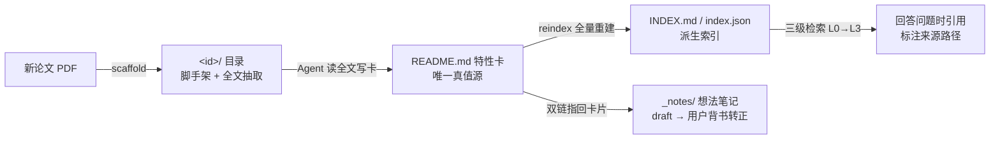

# paper-library —— 论文库 skill

把「躺在文件夹里的 PDF」变成「能被检索、能被复用的知识单元」。
每篇论文一张结构化**特性卡**（真值源）+ **深度分析** + 全文抽取，配三级渐进检索；
在此之上叠一层**想法笔记**（聚合 / 对比 / 检索留痕，AI 起草、用户背书转正）。

## 架构：逻辑与数据分离

| | 位置 | 职责 |
|---|---|---|
| **逻辑（本目录）** | `~/.workbuddy/skills/paper-library/` | 工作流、协议、模板、确定性脚本 |
| **数据（论文库）** | `E:/parper/`（根目录见 `config.json`） | 论文目录、特性卡、索引、想法笔记 |

升级 skill 不碰论文数据；论文库搬家只改 `config.json` 的 `library_root` 一行。



## 五个工作流（Agent 侧入口见 SKILL.md）

| 工作流 | 干什么 | 用户触发词举例 |
|---|---|---|
| A 入库 Ingest | scaffold → Agent 写卡写分析 → reindex | 「把这篇 PDF 加进库里」 |
| B 检索 Retrieve | L0 索引 → L1 search → L2 读卡 → L3 深读 | 「库里有没有讲 X 的」 |
| C 维护 Maintain | 补卡 / 查漏 / 改名同步 id | 检索失败一次就修一次卡 |
| D 版本 Git | 入库/维护完成且 reindex 成功后提交 | 「提交」 |
| E 想法笔记 Ideas | AI 起草 draft → 用户背书转正 | 「把这段分析存成笔记」「记一下我的想法」 |

## 用户速查（你只管说，落盘归 Agent）

| 场景 | 说 |
|---|---|
| AI 写的分析想留下 | 「把这段分析存成笔记」 |
| 自己冒出想法 | 「记一下，我的想法是……」 |
| 要导航/对比页 | 「把库里 octree 相关的整理成一页」「对比 X 和 Y」 |
| 笔记看过改过 | 「转正」 |
| 看攒了哪些草稿 | 「看下 _notes 里有哪些草稿」 |

## 本目录结构

```
paper-library/
├── SKILL.md                      ← Agent 入口：五个工作流 + 硬规则
├── README.md                     ← 本文件（人读概览）
├── config.json                   ← library_root（换库只改这里）
├── scripts/library.py            ← 唯一脚本：scaffold / reindex / search / list / config / init
├── references/
│   ├── feature-card-schema.md    ← 特性卡字段规范（写卡前读）
│   ├── retrieval-protocol.md     ← 三级检索协议 + 引用规范
│   ├── notes-protocol.md         ← 想法笔记协议（写笔记前读）
│   └── git-workflow.md           ← Git 提交规则
└── assets/templates/
    ├── feature-card.md           ← 特性卡正文模板
    ├── analysis.md               ← 深度分析模板
    └── note.md                   ← 想法笔记模板
```

## 常用命令

```bash
PY="C:/Users/df789/.workbuddy/binaries/python/versions/3.13.12/python.exe"
LIB="C:/Users/df789/.workbuddy/skills/paper-library/scripts/library.py"

"$PY" "$LIB" scaffold "E:/parper/_inbox/SomePaper.pdf"   # 新论文入库脚手架
"$PY" "$LIB" reindex                                      # 改卡片后重建索引
"$PY" "$LIB" search "B-rep 拓扑" --limit 5                # 关键词检索
"$PY" "$LIB" search --tag octree                          # 按 tag 检索
"$PY" "$LIB" list                                         # 列出库内论文与 tag
"$PY" "$LIB" config                                       # 查看库根目录等配置
```

## 关键设计决策

| 决策 | 换来什么 |
|---|---|
| 真值源唯一（README frontmatter），索引全量重建 | 索引永不漂移 |
| 脚本只做确定性 I/O，语义由 Agent 写 | 可重复步骤零 token，语义步骤有质量 |
| 三级渐进检索，L2（特性卡）是常态终点 | 库大也能一页初筛 |
| `_` / `.` 前缀 = 辅助目录，扫描器跳过 | `_inbox` `_docs` `_notes` 不污染索引 |
| 想法笔记 `draft: true`，用户背书才转正 | AI 管派生与结构，用户管判断与背书 |
| frontmatter 兼容 Obsidian properties | 论文库可直接兼作 Obsidian vault |

完整设计与验证记录见 `E:/parper/_docs/paper-library 设计说明.md`。

## 环境与依赖

- Python：托管版本 `C:/Users/df789/.workbuddy/binaries/python/versions/3.13.12/python.exe`
- PDF 抽取：`pypdf`（已装，6.19.0）。扫描版无文本层时用 Read 工具或 `pdf` skill 兜底
- 论文 PDF 走 Git LFS（`E:/parper` 侧 `.gitattributes` 已配好）

## 维护注意事项（踩过的坑）

- **CRLF 硬约束**：本仓库与论文库的 `.gitattributes` 都约定 `*.md` 等文本文件工作区为 CRLF，
  且系统 / 全局 / 仓库三层都开了 `core.safecrlf=true`。Agent 工具写出的新文件默认 LF，
  **git add 前必须先归一**，否则报 `fatal: LF would be replaced by CRLF`：
  ```bash
  sed -i 's/\r$//; s/$/\r/' <文件>
  ```
- 论文目录改名必须同步 frontmatter 的 `id` 再 `reindex`。
- `scaffold` 按 PDF 文件名建目录——源文件用论文全称命名会得到超长目录名，
  入库后**立刻**把目录改成论文短名并同步 `id`。
- 不要手工编辑 `INDEX.md` / `index.json`（派生产物）；不要用 `--force` 冲掉已有卡片。

## 相关文档

- Agent 用：`SKILL.md`（入口）→ `references/*.md`（按工作流按需加载）
- 人读：`E:/parper/_docs/paper-library 设计说明.md`（完整设计说明）
- 用户速查另一份：`E:/parper/_notes/README.md`
