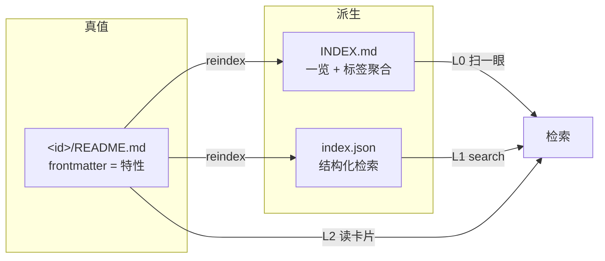

# Paper Library —— 论文库的入库与检索

## Overview

把论文从「躺在文件夹里的 PDF」变成「能被检索、能被复用的知识单元」。

每篇论文一个子目录，目录里有三样东西，各自职责严格分开：

| 文件 | 职责 | 谁读 |
|------|------|------|
| `<id>/README.md` | **特性卡**：frontmatter 结构化字段 + 精炼正文 | 检索时的**唯一默认入口** |
| `<id>/analysis.md` | **深度分析**：方法细节、公式、超参、复现要点 | 真要动手时才读 |
| `<id>/<原名>.pdf` + `*_extracted.txt` | 原文与全文抽取 | 校验细节时的兜底 |

根目录还有两个**派生产物**：`INDEX.md`（人读一览）与 `index.json`（机器检索）。
两者都由 `README.md` 的 frontmatter 全量重建，**永远不要手工编辑**。



## 职责边界（最重要的一条）

`scripts/library.py` **只做确定性 I/O**：建目录、抽全文、生成脚手架、重建索引、关键词打分。
它**永远不会**替你写 `problem` / `core_idea` / `reuse_when`。

**读懂论文并把特性写出来，是 Agent 的工作。** 不要指望脚本产出知识。

## 工作流 A：新论文入库（Ingest）

触发：「把这篇论文加进库里」「读一下这个 PDF 并入库」。

```bash
# 0. 确认论文库位置（换过目录的话先看这里）
python <skill>/scripts/library.py config

# 1. 脚手架：建目录 + 复制原文 + 抽全文 + 生成两份文档骨架
python <skill>/scripts/library.py scaffold "E:/parper/_inbox/SomePaper.pdf"
```

脚本跑完会打印「下一步」清单。接下来由 Agent 做语义工作：

2. **把目录名改成论文短名**（`id`）。`scaffold` 是按 PDF 文件名建目录的，
   源文件用论文全称命名时会得到超长目录名（如
   `ManifoldPlus A Robust and Scalable Watertight Manifold Surface Generation Method`）。
   `mv` 之后**立刻同步改 `README.md` 的 `id`**，否则 reindex 后 `id` 与目录不一致。
3. **读全文**（`<id>/*_extracted.txt`）。长文先读摘要/引言/结论 + 各节标题，再按需精读。
4. **填 `<id>/README.md` 的 frontmatter** —— 字段规范见 `references/feature-card-schema.md`。
   必填：`tags` `problem` `core_idea` `reuse_when`。**这四个字段决定它日后能不能被搜到**，
   宁可多花时间在这里，也不要敷衍。
5. **写 `<id>/README.md` 正文**（按模板提示，一句话总结 → 解决的问题 → 核心思路 → 关键机制 → 结果 → 局限 → 何时可复用）。
6. **写 `<id>/analysis.md`**：放正文里塞不下的细节（公式、超参、训练成本、复现坑）。
7. **改 `status: summarized`**，然后重建索引：

```bash
python <skill>/scripts/library.py reindex
```

8. **补互链**（可选但推荐）：若确定与库内某篇相关，把两边的 `related` 都写上，再 `reindex` 一次。
9. **记录入库历史**：确认 `status: summarized` 且 `reindex` 成功后，按「工作流 D」提交本次论文目录与索引。

> 若脚本抽取失败（扫描版 PDF、非标准格式），由 Agent 用 Read 工具（可直接读 PDF）
> 或 `pdf` skill 转出文本，存成 `<id>/<stem>_extracted.txt` 后再继续。

## 工作流 B：把论文库当参考依据（Retrieve）

触发：「这个问题……」「库里有没有关于 X 的」「我之前读过讲 Y 的吗」。

**按三级渐进检索，不要一上来就狂读全文。** 完整协议见 `references/retrieval-protocol.md`。

| 级 | 动作 | 停在哪 |
|----|------|--------|
| L0 | 读 `INDEX.md` | 没有相关的 → 直说没有，用通用知识正常回答 |
| L1 | `library.py search "关键词"` 或 `--tag` | 得 1–3 篇候选 |
| L2 | 读候选的 `README.md` | **常态终点**，通常读到这里就够答题 |
| L3 | 读 `analysis.md` / 全文 | 只在需要精确数字/公式时 |

```bash
python <skill>/scripts/library.py search "B-rep 拓扑 连续表示"
python <skill>/scripts/library.py search --tag GVD --limit 5
python <skill>/scripts/library.py list          # 看库里到底有哪些 tag
```

**回答里必须标注来源**，让人能回溯：

```
（依据 dualBrep 特性卡：GVD-UDF 把拓扑编码为连续场 → E:/parper/dualBrep/README.md）
```

如果是"受这篇启发"而不是论文原结论，要明说是启发。**库里没有就承认没有，不要硬凑。**

## 工作流 C：维护（Maintain）

- **补卡**：回答问题时发现某篇的 `tags`/`reuse_when` 漏了这次用到的场景 → 当场补进 frontmatter → `reindex`。
  这是论文库唯一能长期保持可检索的机制：**检索失败一次，就修一次卡**。
  修改并 `reindex` 成功后，按「工作流 D」提交特性卡与索引。
- **查漏**：`reindex` 会对缺必填字段的卡片报警告，按提示补齐。
- **改名/合并**：直接改目录名会导致 `id` 与目录不一致，务必同步改 frontmatter 的 `id` 后 `reindex`。

## 工作流 D：版本记录（Git）

触发：**入库完成、卡片/深度分析修改完成且 `reindex` 成功之后**。只读检索不触发提交。

- 论文数据只在 `E:/parper` 仓库提交；skill 自身改动在 skill 源码仓库单独提交。
- 提交前确认 scoped `git status` 有实际变化，并运行 `git diff --check`。
- 不使用 `git add -A`；只添加本次论文目录或明确文件，以及 `INDEX.md` / `index.json`。
- 完整命令、维护场景和失败处理见 `references/git-workflow.md`。

## 目录结构

**论文库**（用户数据，根目录见 `config.json`，默认 `E:/parper`）：

```
E:/parper/                        ← 论文库根
├── INDEX.md                      ← 派生：人读一览 + 标签聚合 + 何时可复用
├── index.json                    ← 派生：结构化检索库
├── _inbox/                       ← 未入库的 PDF 先丢这里
├── _docs/                        ← 库自身的说明文档（不属于任何论文）
├── <id>/                         ← 每篇论文一个目录，以论文名命名
│   ├── README.md                 ← 特性卡（真值来源）
│   ├── analysis.md               ← 深度分析
│   ├── <原名>.pdf                ← 原文
│   └── <stem>_extracted.txt      ← 全文抽取
└── <id2>/ ...
```

> 以 `_` 或 `.` 开头的目录一律被当作辅助目录跳过（`_inbox` / `_docs` / 临时目录），
> 论文目录请用正常名字（如 `dualBrep`）。

**本 skill**：

```
paper-library/
├── SKILL.md                      ← 本文件
├── config.json                   ← library_root（换目录只改这里）
├── scripts/library.py            ← 确定性 I/O：scaffold / reindex / search / list / config / init
├── references/
│   ├── feature-card-schema.md    ← 字段定义 + 取值规范（写卡前必读）
│   └── retrieval-protocol.md     ← 三级检索协议 + 引用规范
└── assets/templates/
    ├── feature-card.md           ← README.md 正文模板（frontmatter 由脚本生成）
    └── analysis.md               ← analysis.md 模板
```

## 硬规则

1. **只动论文库根目录之内的文件。** 论文库外的任何仓库、目录一律不碰。
2. **`INDEX.md` / `index.json` 不手工编辑** —— 改 README 后跑 `reindex`。
3. **不覆盖已有内容**：`scaffold` 遇到已存在的 `README.md`/`analysis.md` 会跳过；
   需要重写时先备份再手工改，不要用 `--force` 冲掉别人的分析。
4. **检索优先于生成**：库里已有时，先引用再补充，不要在回答里重新推导一遍已有结论。
5. **`reuse_when` 是给未来的自己看的**，写"什么时候该翻回这篇"，而不是复述论文内容。
6. **Git 提交有边界**：只在入库或维护完成且 `reindex` 成功后提交；不提交空历史；不使用 `git add -A`。

## Resources

- `scripts/library.py` —— 全部确定性操作的唯一入口，`--help` 可看子命令。使用托管 Python：
  `C:/Users/df789/.workbuddy/binaries/python/versions/3.13.12/python.exe`
- `references/feature-card-schema.md` —— 写卡前读一遍，字段取值规范直接决定检索命中率
- `references/retrieval-protocol.md` —— 回答问题要引用库里论文时读
- `references/git-workflow.md` —— 入库或维护完成后的 Git 提交规则与命令
- `assets/templates/*.md` —— 由 `scaffold` 自动使用，一般不需手工打开
