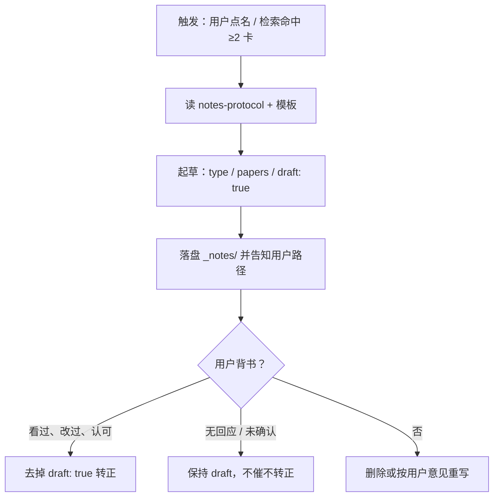

# 想法笔记协议（_notes/ 想法层怎么写）

目标：把论文库从「文献检索层」长出「想法层」——承载从卡片派生出来的聚合、
对比、检索留痕，让知识在论文之间流动，而不只是躺在各自的目录里。

**一句话职责边界：AI 管派生与结构，用户管判断与背书。**

## 与论文卡的关系

| | 论文卡 `<id>/README.md` | 想法笔记 `_notes/*.md` |
|---|---|---|
| 承载 | 单篇论文的**事实**（它做了什么） | 多篇论文之间/之上的**派生认识** |
| 真值 | 论文本身（可对照原文核验） | 用户背书（draft 转正后才可信） |
| 进索引 | 是（INDEX.md / index.json） | 否（`_` 前缀，扫描器跳过） |
| 谁能写 | Agent（读原文后） | Agent 只写 draft；真值判断只能用户写 |

## 三种笔记类型

### 1. 聚合（aggregate）
把一个主题下的卡片串成导航页。适用：某 tag 命中 ≥ 3 篇、或用户问"库里关于 X 一共有哪些"。
写法：每篇一行「链接 + 一句话差异」，不复制卡片内容，只做路由。

### 2. 对比（compare）
两三篇论文在某一个维度上的系统性差异。适用：用户问"X 和 Y 什么区别""哪个更适合我的场景"。
写法：先给结论表，再逐维度展开；每个论断标注来源卡片。
**只对比卡片里有的内容**——卡片没写的维度不要脑补，需要就先去读 analysis.md 或原文，读不到就不写。

### 3. 检索留痕（trace）
一次检索的完整快照：问题 → 检索路径 → 命中卡片 → 结论 + 来源。
适用：一次回答命中了 ≥ 2 张卡、或结论有跨论文价值。
写法：保留问题原文；写明走了哪几级检索（L0→L1→L2）；结论部分可直接复用回答里的表述。

## 文件与 frontmatter 规范

- 位置：`<库根>/_notes/YYYY-MM-DD-<短名>.md`，短名用连字符、全小写英文（如 `2026-10-09-octree-two-ways.md`）。
- frontmatter 字段：

```yaml
---
type: aggregate | compare | trace
title: 一句话标题
created: YYYY-MM-DD
draft: true
papers: [<id1>, <id2>]        # 涉及的论文 id，与目录名一致
tags: []                       # 可选，沿用论文卡的 tag 习惯
---
```

- `draft: true` → AI 起草、未经用户确认。
  用户看过、改过、明确认可后由 Agent（在用户授意时）或用户本人去掉该字段。
  **Agent 不得自行转正。**
- 双链格式：Obsidian 兼容写法 `[[../dualBrep/README|dualBrep]]`；
  同时在正文沿用检索协议的来源标注格式（`（依据 X 特性卡 → E:/parper/X/README.md）`），
  保证在 Git Bash / 纯文本环境里也能回溯。

## 流程



## 禁止事项

- **不写用户真值**：Agent 不代写"我决定用 X 方案""这个教训是……"这类判断；
  用户口述的判断可以由 Agent 记录，但须在正文标明"用户原话/用户观点"。
- **不改论文卡**：笔记只是卡片之上的派生层，发现卡片有错应修卡 + reindex，而不是在笔记里"打补丁"。
- **不进索引**：永远不把 `_notes/` 的内容写进 INDEX.md / index.json。
- **不确定不落盘**：拿不准该不该记、type 选哪个 → 先问用户。
